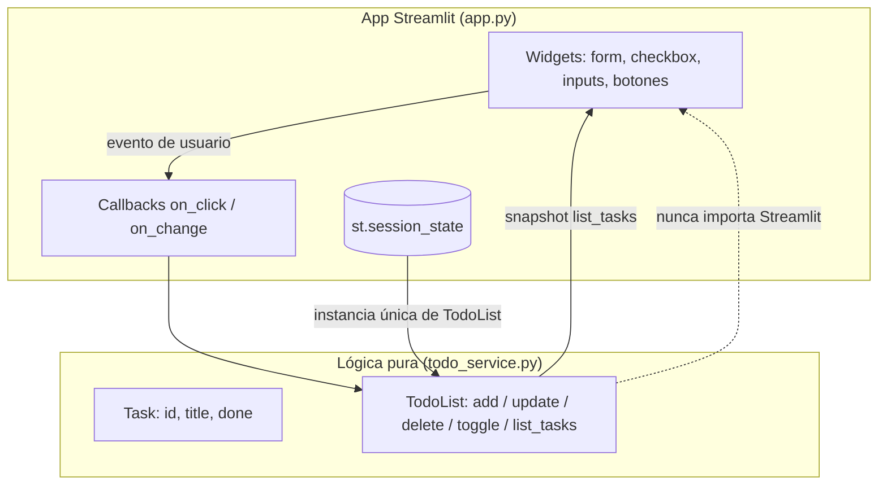

# ToDo App ✅

Aplicación de lista de tareas en **Python + Streamlit** con persistencia
**solo en sesión** (`st.session_state`), sin base de datos.

| Estado | Detalle |
|--------|---------|
| Tests | 34 passed |
| Cobertura | 100 % (`todo_service.py`, 53 statements) |
| Python | 3.11+ |
| UI | Streamlit (http://localhost:8501) |

---

## 1. ¿Qué es?

Una ToDo App web minimalista para agregar, editar, eliminar y filtrar tareas
pendientes/completadas. La lógica de dominio está **desacoplada de la UI**:
`todo_service.py` es un módulo de lógica pura (sin Streamlit) testeable de
forma unitaria, y `app.py` solo se encarga de la interfaz.

> ⚠️ **Persistencia**: los datos viven únicamente en `st.session_state`.
> Al cerrar o reiniciar la app, la lista arranca vacía. **No hay base de
> datos, ni archivos, ni `st.cache_resource`.** Este es un alcance deliberado
> (ver [Sección 7](#7-alcance-explícito)).

## 2. Funcionalidades

| Funcionalidad | Descripción |
|---------------|-------------|
| ➕ Agregar | Alta de tareas desde un formulario; el título se normaliza (`strip()`) |
| ✏️ Editar | Renombrar tarea existente desde un input con botón *Guardar* |
| 🗑️ Eliminar | Borrar tarea por id |
| ☑️ Completar / reactivar | Checkbox que alterna `done` entre pendiente y completada |
| 🔎 Filtrar | Vista *Todas* / *Pendientes* / *Completadas* |
| ⚠️ Validación | Rechaza títulos vacíos o de solo espacios (`ValueError`); la tarea **no** se crea ni se modifica |

Comportamiento de validación en detalle:

- `""`, `"   "`, `"\t"`, `"\n"`, `" \t "` → rechazados.
- `"  comprar leche  "` → se almacena como `"comprar leche"`.
- Títulos no textuales (`None`, `123`, listas, dicts) → rechazados.
- Operaciones por id inexistente → `KeyError` (delete/toggle/update no son idempotentes).

## 3. Requisitos e instalación (Tutorial)

Requisitos: **Python 3.11+**, `python3` y `pip` disponibles.

```bash
# 1. Crear y activar el entorno virtual
python3 -m venv .venv

# 2. Instalar dependencias
.venv/bin/pip install -r requirements.txt
```

Dependencias (`requirements.txt`):

- `streamlit>=1.30` — UI web.
- `pytest>=7.0` — suite de tests.

## 4. Cómo correr la app (How-to)

```bash
.venv/bin/streamlit run app.py
```

Abre [http://localhost:8501](http://localhost:8501) en el navegador.

### Cómo correr los tests

```bash
.venv/bin/python -m pytest tests/ -v          # 34 tests
.venv/bin/python -m pytest tests/ --cov=todo_service --cov-report=term-missing   # con cobertura
```

Resultado esperado: `34 passed`, cobertura **100 %** en `todo_service.py`.

## 5. Estructura del proyecto (Reference)

```
ToDoApp/
├── app.py               # UI Streamlit (solo presentación + callbacks)
├── todo_service.py      # Lógica pura: Task, TodoList, validación
├── tests/
│   └── test_todo_service.py   # 34 tests (AC-1..AC-8 + extras)
├── requirements.txt     # streamlit + pytest
├── .gitignore
└── README.md            # Este documento
```

| Archivo | Responsabilidad | Dependencias |
|---------|-----------------|--------------|
| `todo_service.py` | Dataclass `Task`, clase `TodoList`, validación de títulos, filtros | Solo stdlib (`dataclasses`, `typing`, `uuid`) |
| `app.py` | Render de la UI, formularios, callbacks de Streamlit, estado en sesión | Streamlit + `todo_service` |
| `tests/test_todo_service.py` | Cobertura de criterios de aceptación del PRD | pytest + `todo_service` (sin Streamlit) |

## 6. Arquitectura (Explanation)



### Decisiones de diseño clave

- **Lógica pura separada de la UI** (AC-8): `todo_service.py` no importa
  Streamlit; se puede testear y reutilizar sin entorno web.
- **Persistencia en sesión**: `_get_todo_list()` crea la única instancia de
  `TodoList` guardada en `st.session_state["todo_list"]`.
- **Patrón de callbacks**: todas las mutaciones (agregar, toggle, guardar,
  eliminar) corren en callbacks de Streamlit, que se ejecutan **antes** del
  re-render. Así nunca se muta la lista mientras se itera sobre la vista
  anterior y no se usa `st.experimental_rerun` (deprecado).
- **Snapshot en el render**: la lista se dibuja iterando sobre
  `list_tasks(filter)`, que devuelve una lista nueva.
- **Validación centralizada**: `_validate_title()` normaliza (strip) y
  garantiza el invariante *título nunca vacío* en `Task.__post_init__`.
- **Ids `uuid4().hex`**: acceso O(1) por id mediante diccionario ordenado por
  inserción (Python ≥ 3.7).

## 7. Alcance explícito

**Incluido:** CRUD de tareas en sesión, filtros por estado, validación de
títulos, tests unitarios con cobertura 100 %.

**NO incluido (deliberadamente fuera de alcance):**

- ❌ Sin login / autenticación / usuarios.
- ❌ Sin APIs de IA ni integraciones externas.
- ❌ Sin base de datos ni persistencia entre reinicios.
- ❌ Sin deploy / Dockerfile / CI (por ahora).

Cualquier evolución hacia estos temas debe plantearse como nuevo PRD en Lemoria.

## 8. Trazabilidad

- **Commit**: `306f5b13ef9dcf3cdd788486eb4dd53f1ec86034` — `feat: ToDo app en Streamlit con tareas en sesión`
- **PRD**: `996b2757-01c6-43b8-8165-54d41b41c1e9` — en Lemoria
  (Postgres local / docker `lemoria-db`, proyecto **ToDoApp**
  `9534b9bf-d4db-40d5-9004-d6d390edd4ff`).
- **Criterios de aceptación cubiertos**: AC-1..AC-8 (ver `tests/test_todo_service.py`).

## 9. Licencia

Sin licencia definida — proyecto de aprendizaje/experimentación.